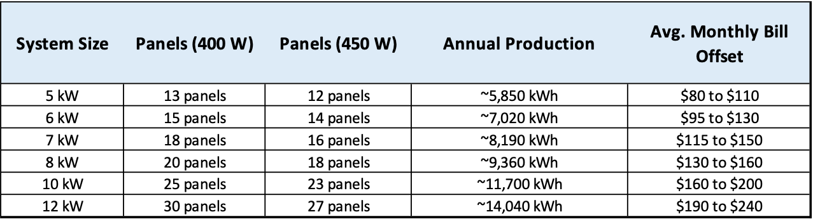
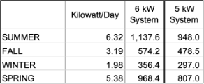
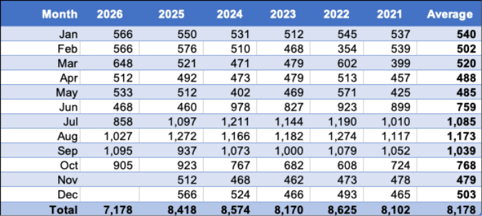
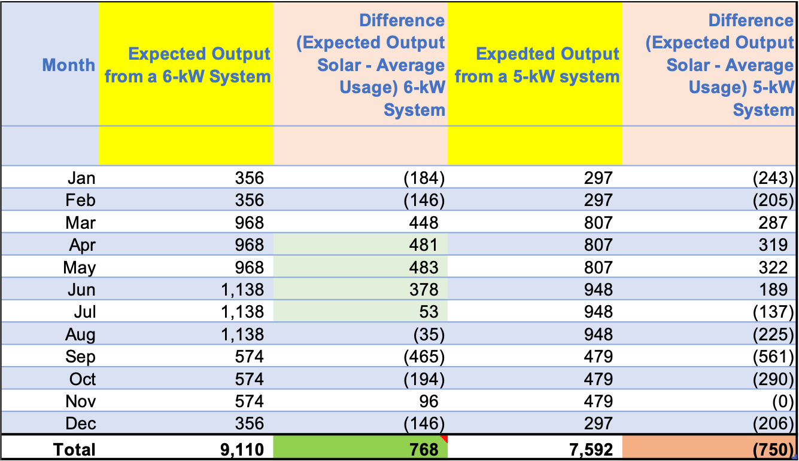
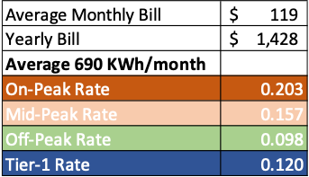
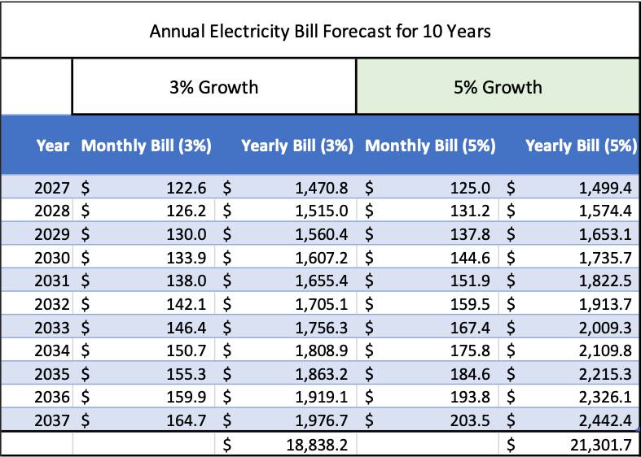
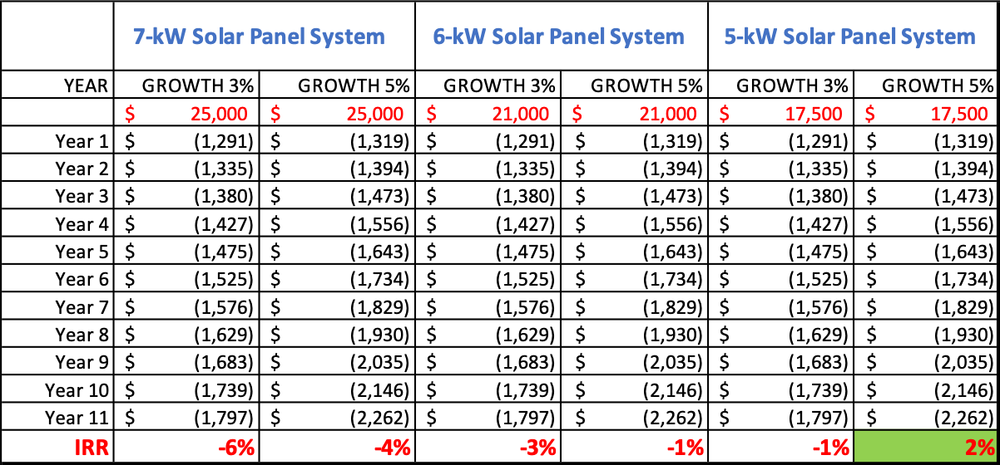
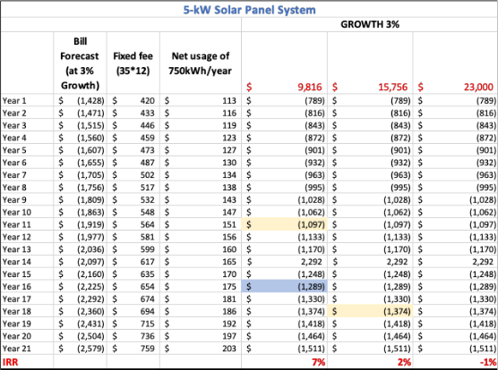
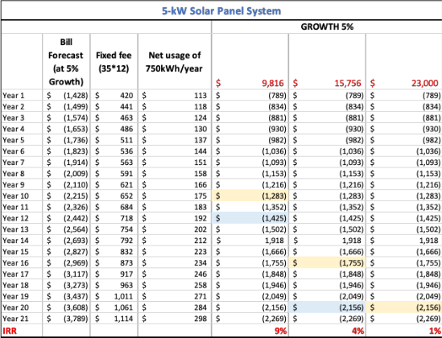

## *In Southwestern Ontario*
{: style="text-align: center;"}

**By: Ingrid Diaz**
{: style="text-align: center;"}

If you are curious about adding solar panels, understand more about bills, and finding out how to evaluate this kind of investment for your home.

## Part 1

## I Am Curious About This Whole “Solar” Situation.

I would like to understand, whether installing solar panels in my home would make economic sense and in which conditions. The government seems supportive of residential solar installations; however, in my area, the movement appears to be losing momentum. Southwestern Ontario has some of the best solar potential in the country, so I would expect to see far more homes covered in solar panels.

This article is an evaluation of whether the average 2,880 square foot household of three would see returns back in the foreseeable future and a bit of an analysis on the typical household consumption. As many Canadian families saw increase in their electric bills in recent years, I became curious about the viability of installing a solar panel system and its potential role in off-setting the costs for Canadian households.

## Some Information on Solar Panel Systems

The working principle of a solar panel is based on the photovoltaic effect. When sunlight hits the solar cells, the photons release electrons into the semiconductor material (usually silicon). This movement of electrons generates a direct electric current (DC), which forms the basis of the energy produced. Next this system is connected to an inverter, which transforms the direct current into an alternating current (AC).

There are three main types of solar technology: **Photovoltaic**, **Thermal** and **Hybrid** Solar Panels.

Under the Photovoltaic we have three types of panels and the Monocrystalline is the most popular type used in residential construction.

**Monocrystalline panels:** Considered the gold standard for residential roofs, made of highly pure form of silicon, and the highest efficiency rates in the market. These can have a lifespan anywhere from 25 to 40 years.

**Polycrystalline panels:** Made of raw silicon, are less efficient take up more space. Not for hot climates. Though considered much cheaper.

**Amorphous or thin-film solar cells:** These types of solar panels use materials such as amorphous silicon, cadmium telluride, or gallium with photovoltaic properties. As such, a flexible and lightweight panel can be made. However not considered as efficient as conventional photovoltaic panels as it takes up more space and has lifespan of 10 to 20 years.[^1]

For residential properties, solar system sizes can range from 3-kW to 15-kW with the majority of homes installing between 5-kW and 10-kW systems. The average for a 6-kW to 9-kW system is 15 to 22 panels. When considering a system size, three main issues need to be addressed: the electricity bill, the roof space, and the local utility’s grid rules.

#### Table 1 - Panel Count by System Size (Ontario)[^2]

*Figure 1 - Solar Panel System Sizes, Panel Counts, Yearly Output and Bill Offset per Month.*
{: style="font-size: 13px; color: #777; text-align: left;"}

The table above shows the different system sizes and annual production, average monthly offset of installing a system size with their respective panel count. The average Gigajoules per household consumed in Ontario in 2021 was 30 Gigajoules of electricity, or 8,333 kWh.[^3] That means a 7-kW system would suffice for the average household in Ontario.

Solar power seems optimal for those who own a property, face high or rising electricity rates, have a structurally sound roof facing south, east, or west, and experience minimal shade from nearby trees. The payback period is shorter if the property is served by a local utility that offers favorable net-metering credits. [Net Metering](https://www.google.com/goto?url=CAESgAEBxCJF1wLV9V97GPjFCZqOj2hG33qdeyqH-63vqjCxCHVkEVQVdRMFyGnkeCOu3n-aLYpLmnK0-f0whS4r6sxeKkj6za9p8LAdiZBfayzBJeZS2eyJuuCvNzzGaH9R7VZqE8qQZxiPG2rRrSsOdMeKAtgeZ2BnDMAqNQMYYnVykw) is for example, when installed solar panels generate extra power during a sunny July afternoon, the excess flows out to the local hydro grid, and the utility grants the resident a credit on their bill. In Ontario there is a roll-over limit of 12 months. That is, after 12 months any accumulated unused credits expire and reset to \$0. Furthermore, your savings aren't limited to the height of summer—because solar panels actually operate more efficiently in cooler temperatures, crisp, sunny winter days offer impressive generation potential as well.

To figure out the viability of the project, I will split our analysis into two parts:

**Savings and evaluation of electricity bills**: For this section, we need to forecast future electricity consumption and determine the scale of potential savings.

**Cash flows**: Using the results from step one, we will evaluate the cash flows, depicting the savings (and expenses) over time from the investment.

## Historical Use and Evaluation of Usage

The next part of the evaluation takes into consideration the approximate output of a solar panel system in Southwestern Ontario. During the summer, a solar panel system produces approximately 6.32 kWh per day per kilowatt (kW) of installed capacity. At this rate, a 6-kW system would produce approximately 1,137.6 kWh over 30 days.

#### Table 2 – Expected Output by Season of a 5-kW and 6-kW System in Southern Ontario

*Figure 2 - Expected Output for Solar Panel System (IESO).*

The below Table 3 is a sample of historical monthly electricity consumption data over the past six years, for a small household of three, broken down by month. I will calculate the average monthly consumption and subtract the expected solar energy production to determine our net electricity usage, as shown in Table 4.

Our net electricity consumption will vary depending on the season. Looking at Table 4, during the summer months, a 6-kW solar system is expected to generate more electricity than we consume, making us a net contributor to the grid. Based on our calculations, a 6-kW system would produce an annual net surplus of approximately 768.4 kWh. In contrast, a 5-kW system would significantly reduce our electricity bills but would still leave us with an annual net consumption of approximately 750 kWh. Please note net deficits are depicted in brackets. These results suggest that the ideal system size lies somewhere between 5-kW and 6-kW to achieve net-zero annual electricity consumption. However, the price difference is \$2,000 up-front between a 5-kW and 6-kW system. I have decided the net deficit scenario is ideal in my situation as 1. The net metering system credits expire, and I would not receive any monetization for said expired credits and 2. I would not be compensated by the electrical company for providing extra Kilowatts during the year, for which it seems I would be a net contributor to the energy grid under the 6-kW system scenario.

At this stage, our analysis hasn’t accounted for the costs of purchasing, installing, operating, or maintaining the solar system. These financial considerations will be addressed in Part Two of our analysis.

#### Table 3 – Historical Monthly Usage of Electricity Total kWh/Month

*Figure 3 - Historical Monthly Electricity Usage.*

#### Table 4 – Expected Output per Year of a 6-Kilowatt System vs a 5-Kilowatt System[^4]

*Figure 4 - Expected Output - Average Usage of a 6-Kilowatt vs a 5-Kilowatt System. Numbers inside parenthesis are deficits in consumption. Items not in brackets are a net surplus (this means credits are earned).*

## Electric Bills Forecast

A quick evaluation of the sampled historical electricity bills puts the average monthly bill at \$119. This number has increased from the previous year. I have also noted that there have been times when the government has provided assistance through grants, but these tend to be one-off, temporary, or sporadic, and their effects are difficult to identify through the billing.

Next, I need to make a rough estimate of the cash flows associated with investing in a solar panel system. To do this, I need to determine the potential cost savings from the installation. The sampled average monthly electricity usage is 690 kWh, with an on-peak rate of 20.3 cents/kWh and a mid-peak rate of 15.7 cents/kWh. However, the electrical company's website advertises an average cost of 12 cents/kWh per customer. With an average monthly bill of \$119, I estimate the annual electricity bill to be \$1,428. This is a relatively modest estimate.

For the forecast, I have decided to use annual electricity bill increases of 3% and 5% and have projected the billing over the next ten years. These two scenarios will help illustrate how different rates of electricity price increases could affect the potential savings from installing a solar panel system.

#### Table 5 – Bills and Electricity Rates

*Figure 5 - Rates as per Electric company*

#### Table 6 – Annual Electricity Bill Forecast for the Next 10 Years

*Figure 6 - Electricity Bills Forecast Next 10 Years at 3% and 5% Electricity Bill Growth Scenarios.*

## A First Look at the Cash Flows

Next, we will evaluate the cash flows for three different solar panel systems. The three system sizes considered in this analysis are a 7-kW system, which seems capable of covering 100% of our electricity needs; a 6-kW system, which would still generate a surplus; and a 5-kW system, which would leave us with a net deficit. Since we have a net-metering system in place, there is no need to include battery storage in this analysis, as the cost of a battery would significantly increase the overall expenses.

I have included an additional \$180 per year for maintenance expenses after the system has been installed. This is a very rough number and is there purely for evaluation of the time payout as no equipment is in reality maintenance free after installation. This is the simplest scenario for the moment, and the amount is only a rough estimate, and will be refined later as we obtain more information. Comparing the 6-kW and 7-kW systems, an additional \$4,000 in initial costs results in a decrease of approximately 3 percentage points in the estimated rate of return. It is worth remembering that the payback becomes more favorable as electricity bills increase in the future.

My estimates are very aggressive. Even with a 5% annual increase in electricity bills, the 5-kW system is the only one projected to generate a positive return, reaching approximately 2% in Year 11. The 5-kW system is estimated to cost \$17,500, although this is a rough estimate that includes all associated expenses, such as paperwork, labour, installation, etc.[^5]

#### Table 7 – IRR[^6] for 7, 6 and 5-Kilowatt Systems with a \$180 cost of Maintenance

*Figure 7 - Internal Rate of Return for an Ordinary Cash Flow for 7, 6 and 5-kW Systems with \$180 Maintenance and Assuming 3% and 5% Annual Electricity Bill Growth.*

Next, we will refine our analysis through a re-evaluation of energy needs and more detailed information on the costs involved in purchasing, installing and servicing all the components needed.

## Part 2.

## All the Nitty-Gritty Details About Southern Ontario and Quotes from Real Contractors

By this point, I had gathered quite a bit of information and was becoming a little more realistic about my expectations. Then came an actual quote from a local solar panel supplier and installer. The price? \$30,000 CAD for a turnkey installation, quite a jump from the \$17,500 advertised on the Ontario Solar Power website.

I also discovered a few other details that would affect my calculations. First, the electricity company charges a fixed delivery fee of approximately \$35 per month, or \$420 annually[^7]. This fee applies whether I have solar panels or not. Think of it as a grid “membership” fee that I can't escape, even if I generate most of my own electricity. Second, I learned that my roof simply doesn't have enough space for anything larger than a 6-kW system. The contractor also explained that these systems are generally quite reliable during their first ten years, with warranties covering 25 years for the panels, 15 years for the inverter, and five years for labour.

With this new information, I would need to revisit my original estimate of \$180 in annual maintenance expenses, reduce it to \$100 and now account for the \$420 yearly delivery fee, which solar panels wouldn't eliminate. At this stage, I decided to focus the rest of my analysis on a 5-kW system as it’s a more attractive return on investment as shown in Table 4.

Shortly afterward, I received a second quote, this time from another company offering a 5-kW system for \$23,000 CAD. Better than \$30,000, but still considerably more expensive than I had initially expected. And just when I thought I had a clearer picture of the costs, another issue came up: my roof is already ten years old. I was advised to replace the section where the panels would be installed before proceeding. That's yet another potential expense, and one I haven't included in my calculations.

So, between the higher installation prices, the unavoidable delivery fees, the possibility of future maintenance, and now the roof, it's becoming clear that the economics of residential solar are not quite as straightforward as my initial estimates suggested.

## OK, I Need to Add Depreciation Expenses Too, No?

Depreciation is such a mixed bag and I will provide a good breakdown for anyone interested in this subject. However, I quickly realized depreciation wasn’t what I was after. Panel degradation is expected at 0.4% per year. For simplicity, this will not be included in our calculations. The expected lifespan of the complete system is at 25 years. Now, what I was actually looking for is replacement risk, i.e., the chance a component creates a future cash expense. It is calculated as follows:

Replacement risk = probability of failure x out of pocket replacement cost.

Now, the panel system is less risky but: 25 years is a very long time and the technology might be obsolete, the company out of business, electrical standards might have changed. That being said, the above formula is used for the panel maintenance: 11 panels, with 0.1% probability of failure, at \$600 replacement cost per panel (we consider the additional cost of hiring someone, etc.). For a span of 20 years, this gives a value of \$132.

The inverter is the major replacement risk, with one replacement approximately mid-way in the 25-year lifespan. I initially estimated the current cost of a replacement inverter at \$1,750, excluding labour. Including an additional \$1,750 for an electrician, the total estimated replacement cost would be \$3,500. This will be accounted for in the final cash-flow calculations.

The rest of the maintenance expenses I estimate at \$100 per year. This is really just a cover for anything that might arise over the span of the system. Remember this value is more likely to be zero for the first few years of the installation.

Expected panel repairs (\$6.60 \* 20) = \$132.

Expected inverter replacement \$1,750 + \$1,750 (electrician) = \$3,500.

Routine maintenance (\$100 \* 20) = \$2,000.

## A Little More Refinement…

I focused my cost analysis on a 5-kWh system for two reasons: my roof can't fit anything larger, and annual surpluses would waste expiring net metering credits. However, I need to refine my numbers because a 5-kWh system won't cover all my electricity needs like a 6-kWh setup would. This leaves a net usage of 750 kW per year, which adds \$90 in annual costs (at 12 cents per kW) and lowers my projected savings.

The contractor mentioned a local company called Canadian Solar. I went on their website and found they sell panels at various price levels and can cost \$160 per panel[^8]. I would need 11 panels; my main hardware stack looks like this:

### 

### Hardware:

1.  Canadian Solar panels: **~\$1,650–\$1,950.**

2.  Solis 5-KW inverter: **~\$1,850–\$2,340.**

3.  Roof racking/attachments: **~\$900–\$1,200.**

4.  Rapid-shutdown devices: **~\$550–\$700.**

5.  Wiring, conduit, breaker, disconnect, grounding, labels, monitoring: probably **~\$1,000–\$2,000.**

Our total cost for parts now goes from lower **\$5,950** to upper **\$8,190**. So, it seems the main price increase is in labour, and certifications, inspections, etc.

### Permits and fees:

**Town permit:** \$80.  
**ESA inspection/notification:** \$336.  
**Drawings/design:** \$300–\$600.  
**Structural review:** \$0–\$750.  
**Utility meter/connection:** \$500–\$1,000 provisional allowance.  
**Labels/documentation/miscellaneous:** \$150–\$300.

Ok, this takes it from **\$1,366** to **\$3,066**.

### Now for the labour:

**Roof crew/mechanical installation:** ~\$1,500–\$2,500.  
**Licensed electrician/solar electrical work:** ~\$1,000–\$2,000.  
**Total labour:** roughly **\$2,500–\$4,500**.

Everything together can go for lower end between **\$9,816** and upper end **\$15,756**. This is much better than the **\$23,000** I was quoted for turnkey. I will produce one last set of two spreadsheets, with the different initial costs and the below additional costs into the investment. I will produce one final set of spreadsheets, using the different initial costs and incorporating the additional expenses outlined below.

### Factors affecting the Project Investment return:

• **Installation:** Scenarios of \$9,816, \$15,756 and \$23,000 today.

• **Electricity price increases:** Estimated annual increases of 3% and 5%.

•  **Fixed delivery fee:** of \$35 a month, or \$420 per year.

• **Yearly production vs savings:** Actual solar kW × actual avoidable \$/kW.

• **Inverter:** middle case with a 50% chance of \$3,500 replacement, discounted from around year 11; Or conservative case assumes the full replacement cost (used this scenario).

• **Maintenance and panel repairs:** \$2,132 (as calculated in previous section).

• **Discount Rate:** 4%.[^9]

The first half of Table 8 displays the bill forecast for projected savings assuming a 3% average annual increase in electricity prices, which is considered a relatively conservative scenario. The second column shows the fixed \$35 electricity disposal fee, so that is not a saving and must be removed from our savings. The third column is the net usage, as a 5-kW system is not covering all the expenses, this must be added as well.

I have decided to include the remaining costs directly in the cash-flow column. The inverter replacement was added as a \$3,500 expense in Year 14, assuming a complete replacement and payment in full during that year. That price should also cover labour. Maintenance and panel repairs have been accounted for each year at \$100 and \$6.60, respectively, throughout the 21-year IRR calculation.

## Final Evaluations

Looking at the cash-flow projections below, assuming a 3% average annual increase in electricity prices over a 21-year span, we get an Internal Rate of Return of 7%. The projected IRR reaches 0% by Year 11 (yellow) and approximately 4% by Year 16 (blue), matching our assumed discount rate. That is, if I were to buy myself a 20-year Canadian bond yielding 4%, my return on this investment would be comparable to that bond at the 16th year of the investment. Put simply, if you put \$10,000 into that 4% bond and let it compound each year, you would walk away with about \$18,730 after 16 years (\$8,730 in profit)—meaning this project puts that same equivalent value in your pocket by Year 16.

By the end of the 21-year projection, the solar investment would have generated an estimated IRR of 7%. Based on these calculations, it seems reasonable to conclude that the initial installation cost should fall somewhere between \$9,816 and \$15,756 to achieve the projected returns, with discounted break-even occurring around Year 16. These results are based on a relatively conservative assumption of 3% annual growth in electricity prices.

#### Table 8 - Projected 21-Year Cash Flows and Internal Rates of Return (IRR) for a 5-kW Solar Panel System, Assuming 3% Annual Electricity-Bill Growth and 4% Discount Rate

*Figure 8 - Projected 21-Year Cash Flows and Internal Rates of Return (IRR) for a 5-kW Solar Panel System, Assuming 3% Annual Electricity-Bill Growth. In Blue: Net 4% IRR = 4% Discount Rate.*

For the 5% scenario, things look even more optimistic. The break-even point occurs in Year 10 (in yellow) for the lowest-cost scenario and Year 16 for the middle-cost scenario. However, when comparing the returns against our 4% discount rate, the break-even point would fall somewhere between Years 12 and 20. That is, if I had invested my money elsewhere at a 4% annual return, my solar investment would reach a comparable return sometime between Years 12 and 20, assuming that the total system installation costs were somewhere between \$9,816 and \$15,756.

The turnkey scenario still generates a positive return of 1%. The rates of return for all three scenarios are 9%, 4%, and 1%, respectively. At \$23,000 for a 5-kW system, even with a 5% annual increase in electricity prices, which is a relatively ambitious growth assumption, the investment generates a positive return but is still not a good enough deal.

#### Table 9 - Projected 21-Year Cash Flows and Internal Rates of Return (IRR) for a 5-kW Solar Panel System, Assuming 5% Annual Electricity-Bill Growth and 4% Discount Rate

*Figure 9 - Projected 21-Year Cash Flows and Internal Rates of Return (IRR) for a 5-kW Solar Panel System, Assuming 5% Annual Electricity-Bill Growth. In Blue: Net 4% IRR = 4% Discount Rate.*

## Conclusion

I can see why solar panel systems are not as popular as I imagined. They still come with a very steep upfront cost, and it’s a shame, as Southwestern Ontario receives plenty of sunshine. The turnkey scenario is particularly expensive.

I do believe I have been as generous as possible with this project evaluation. I have given it a generous electricity price growth while excluding depreciation expenses. Moving forward, two major variables could swing the value of this project. First, to the potential upside, would be purchasing an electric vehicle (EV). This would significantly increase household electricity consumption, leading to greater long-term savings from the solar panels.

Second, to the potential downside would be needing a roof replacement or major repairs prior to installation would add a substantial upfront expense, further lowering the return on investment.

Ultimately, transitioning to solar energy in Southwestern Ontario is less about the availability of sunshine and more about the initial costs of the investment. For this project, I will assume a 3% annual increase in electricity prices, since it’s the more conservative scenario. I will also assume an installation cost of \$15,756, which would result in an estimated annualized return of 2% on my investment. This is comparable to the return on a low-yield investment held in a savings Account. Shopping around is the best option and could be a game changer, as it could reduce the initial costs considerably. Would I consider this investment? Yes, as long as I stay below the \$15,000 cost threshold.

[^1]: https://www.repsol.com/en/energy-move-forward/energy/types-of-solar-panels/index.cshtml

[^2]: https://solarcalculatorcanada.org/blog/how-many-solar-panels-ontario

[^3]: https://www150.statcan.gc.ca/t1/tbl1/en/tv.action?pid=2510006001

[^4]: Numbers in parenthesis means net deficit in consumption for that month.

[^5]: https://solarcalculatorcanada.org/solar-ontario

[^6]: Internal Rate of Return (IRR) is a financial metric used to estimate the profitability of potential investments. It represents the annual rate of growth that an investment is expected to generate, taking into account both the initial upfront cost and the cash inflows/savings generated over time.

[^7]: https://essexpowerlines.ca/accounts-services/billing/rates/

[^8]: https://www.santansolar.com/product/new-grade-b-canadian-solar-525w-bifacial-solar-panel/

[^9]: https://www.marketwatch.com/investing/bond/tmbmkca-20y?countrycode=bx
